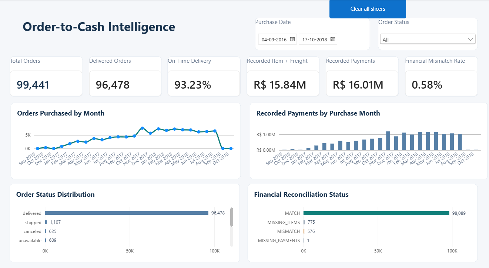
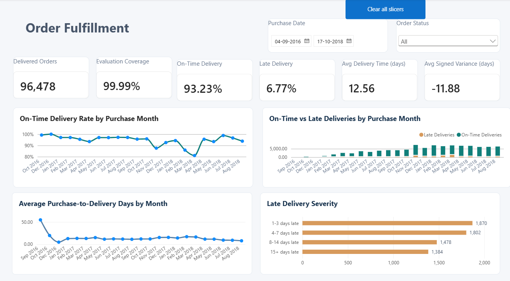
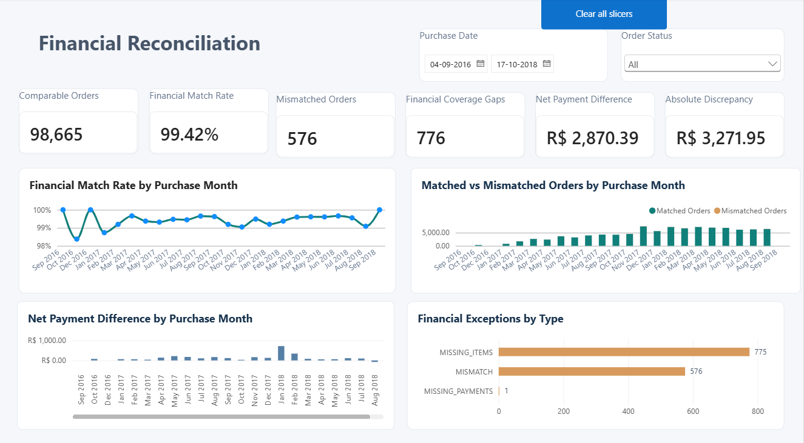
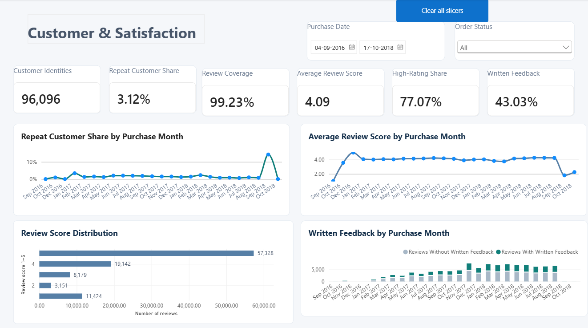
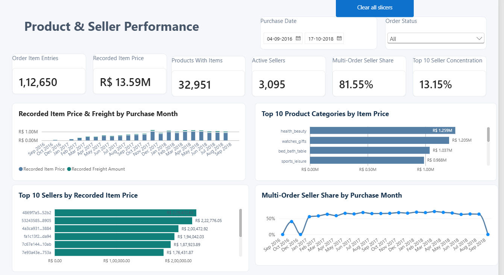
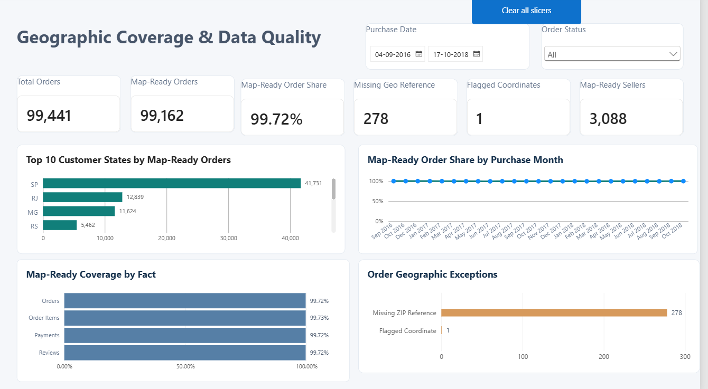

# Order-to-Cash Intelligence Platform

### End-to-End E-Commerce Analytics Engineering & Business Intelligence

**PostgreSQL | Python | Power BI | SQL | DAX | Data Modeling | Data Quality**

An end-to-end analytics platform built using the historical Brazilian E-Commerce Public Dataset by Olist.

The project transforms marketplace order, customer, item, seller, payment, review, and geographic data into a validated PostgreSQL analytical warehouse and a six-page Power BI reporting solution.

The focus is on **traceable business metrics, correct data grain, independent validation, and decision-ready reporting**.

---

## Project at a Glance

| Component | Implemented |
|---|---:|
| Historical marketplace orders | 99,441 |
| Imported analytics tables | 12 |
| Dimension tables | 8 |
| Fact tables | 4 |
| Power BI model relationships | 20 |
| Documented business KPIs | 55 |
| Dashboard pages | 6 |
| Dashboard KPI cards | 36 |
| Dashboard analytical charts | 24 |

**Data period:** 2016–2018  
**Currency:** Brazilian Real (BRL / R$)  
**Development:** PostgreSQL, Python, Power BI Desktop  
**Dataset:** [Brazilian E-Commerce Public Dataset by Olist](https://www.kaggle.com/datasets/olistbr/brazilian-ecommerce)

All figures describe historical source records. They are not live marketplace performance statistics.

---

## Business Problem

Marketplace analysis spans multiple transaction grains:

- One order can contain multiple items.
- One order can have multiple payment records.
- One order may have more than one review record.
- One customer identity may be associated with multiple orders.
- Product and seller filters do not automatically apply to whole-order financial facts.
- Purchase, delivery, and review dates represent different business events.
- Geographic reference records may be missing or unsuitable for mapping.

Combining these sources incorrectly can inflate monetary totals, distort customer metrics, or produce misleading operational KPIs.

This platform addresses those challenges using a structured warehouse, a documented semantic model, and independently reconciled business measures.

---

## Platform Architecture

The data follows a layered analytical workflow:

**Olist CSV data → Python profiling and ingestion → PostgreSQL raw → staging → analytics → Power BI semantic model → dashboards and QA**

The analytics layer contains eight dimensions and four facts:

- `analytics.fact_orders`
- `analytics.fact_order_items`
- `analytics.fact_payments`
- `analytics.fact_order_reviews`

The reporting model uses 20 active one-to-many, single-direction relationships, with independent date-role dimensions and documented calculations.

See the [Architecture & Data Model](docs/architecture.md) for the detailed workflow.

---

## Six Power BI Dashboards — Screenshots & Technical Implementation

The following screenshots show the six completed report pages.

The dashboards support interactive filtering in the
locally maintained Power BI Desktop report.

This public repository provides screenshots,
warehouse SQL, DAX definitions, KPI documentation,
and independent validation evidence.

The PBIX binary is intentionally not distributed
through this repository; GitHub visitors cannot
interact with the report directly.

### 01 — Executive Overview

Tracks order volume, delivery performance, recorded item and payment amounts, order statuses, and reconciliation quality.

### 02 — Order Fulfillment

Analyzes on-time and late deliveries, purchase-to-delivery duration, monthly fulfillment trends, and late-delivery severity.

### 03 — Financial Reconciliation

Separates comparable, matched, mismatched, and financially incomplete orders.

Includes net payment differences and absolute discrepancies.

### 04 — Customer & Satisfaction

Examines distinct customer identities, repeat ordering within selected cohorts, review coverage, ratings, and written feedback availability.

### 05 — Product & Seller Performance

Explores recorded item-price activity, product categories, active sellers, repeat seller participation, and Top 10 seller concentration.

### 06 — Geographic Coverage & Data Quality

Analyzes customer-state distribution and geographic completeness across Orders, Order Items, Payments, and Reviews.

Uses native Power BI visuals without requiring Azure Maps or Power BI Service.

For detailed metric definitions and visual explanations, see the [Dashboard Guide](docs/dashboard_guide.md).

---

## Selected Validated Results

| Business metric | Historical result |
|---|---:|
| Total orders | 99,441 |
| Delivered orders | 96,478 |
| On-time delivery rate | 93.23% |
| Recorded item price | R$13,591,643.70 |
| Recorded freight | R$2,251,909.54 |
| Recorded payment volume | R$16,008,872.12 |
| Financial match rate | 99.42% |
| Mismatched comparable orders | 576 |
| Distinct customer identities with orders | 96,096 |
| Repeat-order customer share | 3.12% |
| Average review score | 4.09 / 5 |
| Active sellers | 3,095 |
| Top 10 seller item-price concentration | 13.15% |
| Map-ready order share | 99.72% |

### Interpretation

- Recorded payment volume is not verified financial settlement or revenue recognition.
- Recorded item-price totals are not seller profit.
- Financial match rate uses comparable orders as the denominator.
- On-time rate uses delivery-evaluable orders.
- Repeat customer share refers to repeated ordering within the selected purchase cohort.
- Review score is weighted by review records.
- Geographic readiness is based on screened ZIP-prefix reference information.

See [KPI Dictionary](docs/kpi_dictionary.md) for the detailed metric specifications.

---

## Engineering & Analytical Highlights

**1. Grain-aware warehouse design**

Maintained separate fact tables for Orders, Order Items, Payments, and Reviews to avoid accidental double counting.

**2. Structured data quality controls**

Profiled source data, reconciled source-to-analytics populations, documented financial coverage gaps, and retained geographic quality exceptions.

**3. Financial reconciliation**

Classified order-level payment versus item-and-freight comparisons into matched, mismatched, and missing-record groups.

**4. Dimensional semantic model**

Implemented 20 validated relationships with single-direction filtering and separate purchase, delivery, and review date roles.

**5. Reusable business KPI definitions**

Documented 55 KPIs and implemented measures for operational, financial, customer, seller, review, and geographic analysis.

**6. Independent quality assurance**

Validated Power BI results with DAX Query View and read-only PostgreSQL audit queries across the complete historical dataset and a Q1 2018 delivered-order cohort.

---

## Repository Contents

| Folder | Description |
|---|---|
| `scripts/` | Python scripts used for source profiling and processing |
| `sql/` | PostgreSQL warehouse development and validation SQL |
| `powerbi/dax/` | DAX measure definitions and validation queries |
| `docs/` | Architecture, KPI dictionary, QA evidence, and reproducibility instructions |
| `assets/screenshots/` | Six dashboard screenshots |

The original CSV files, database backups, and local PBIX binaries are intentionally not included in the public repository.

---

## Reproducibility

The public repository provides source scripts, SQL/DAX logic, dashboard screenshots, and validation documentation.

To work with the original dataset:

1. Download the Olist dataset from the original Kaggle source.
2. Place the nine source CSVs in `data/raw/`.
3. Configure a local PostgreSQL environment.
4. Follow the project's existing ingestion, transformation, and warehouse build scripts.
5. Run the documented PostgreSQL QA queries.
6. Open the locally maintained Power BI report, or construct the report using the documented semantic model and DAX definitions.

See [Reproducibility Guide](docs/reproducibility.md).

**Important:** Cloning this repository does not automatically recreate the complete Power BI report. The PBIX binary is deliberately excluded, and the documented environment and pipeline dependencies must be configured locally.

---

## Validation

The six-page release candidate passed:

- Full-dataset KPI checks
- Q1 2018 delivered-cohort regression checks
- DAX release checks R1–R3
- Independent PostgreSQL release checks R1–R4
- Semantic model relationship checks
- Dashboard interaction and slicer checks
- Visual formatting review

See:

- [Validation and QA](docs/validation.md)
- [Release QA Document](docs/powerbi_release_qa_7_5.md)

---

## Project Documentation

- [Architecture & Data Model](docs/architecture.md)
- [Dashboard Guide](docs/dashboard_guide.md)
- [Reproducibility Guide](docs/reproducibility.md)
- [Validation and QA](docs/validation.md)
- [Portfolio Case Study](docs/portfolio_case_study.md)
- [Dataset Attribution and License](docs/data_source_and_license.md)
- [KPI Dictionary](docs/kpi_dictionary.md)

---

## Dataset Attribution & Usage

Original dataset:

**Olist — Brazilian E-Commerce Public Dataset**

https://www.kaggle.com/datasets/olistbr/brazilian-ecommerce

Dataset license: **CC BY-NC-SA 4.0**.

The original CSV files are not redistributed here. Obtain the dataset from the original publisher and comply with its license.

This is an independent educational and portfolio analytics project and is not affiliated with or endorsed by Olist.

See [Dataset Attribution and License](docs/data_source_and_license.md).

---

## Limitations

- Historical dataset, not live production data
- Source-recorded payments are not confirmed cash settlement
- Source-recorded item prices are not recognized revenue or profit
- Customer identifiers are pseudonymous source identifiers
- Some orders have multiple review records
- Purchase date and review creation date have different analytical roles
- Geographic reference coordinates are not exact addresses
- The public repository does not contain the full Power BI binary or raw dataset

---

## Project Status

**Six-page dashboard:** Complete  
**Warehouse and semantic model:** Validated  
**DAX/PostgreSQL reconciliation:** Passed  
**Portfolio documentation:** Complete for publication review

This project demonstrates the design of a governed, testable analytics solution using a real-world transactional dataset.

