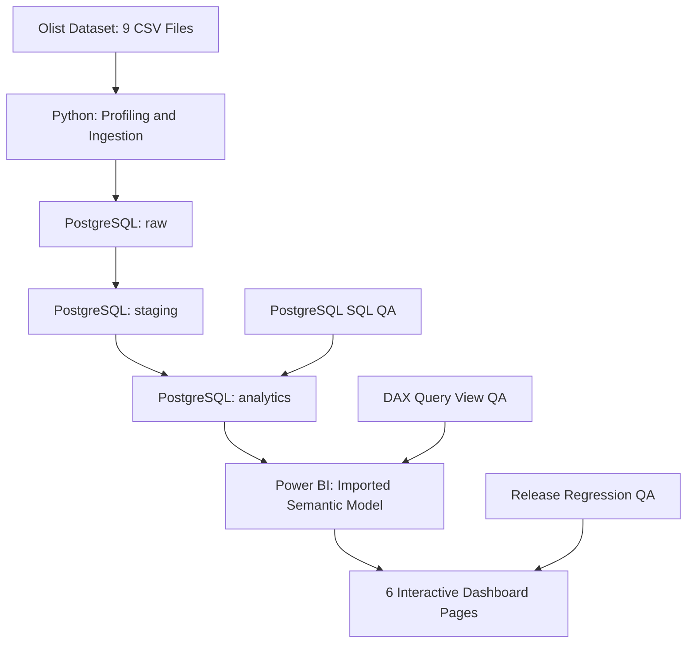
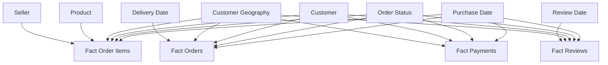

# Architecture & Data Model

## 1. Overview

The Order-to-Cash Intelligence Platform transforms the historical Olist marketplace dataset into an analytical PostgreSQL warehouse and six-page Power BI reporting solution.

The architecture separates source ingestion, data standardization, analytics modeling, semantic calculations, dashboard presentation, and independent quality assurance.

## 2. End-to-End Architecture

The three PostgreSQL schemas have distinct purposes:

| Layer | Purpose |
|---|---|
| `raw` | Preserve ingested source information |
| `staging` | Standardize and prepare source data |
| `analytics` | Publish dimensional reporting tables |

## 3. Analytics Warehouse

The Power BI report imports twelve analytical tables.

### Eight Dimensions

| Table | Purpose |
|---|---|
| `analytics.dim_order_status` | Order status attributes |
| `analytics.dim_product` | Product-level attributes and classifications |
| `analytics.dim_seller` | Seller reference information |
| `analytics.dim_customer` | Customer identity attributes |
| `analytics.dim_customer_geography` | Customer location reference and quality flags |
| `analytics.dim_purchase_date` | Purchase-date reporting |
| `analytics.dim_delivery_date` | Delivery-date reporting |
| `analytics.dim_review_date` | Review-creation-date reporting |

### Four Facts

| Table | Grain | Historical rows |
|---|---|---:|
| `analytics.fact_orders` | One order | 99,441 |
| `analytics.fact_order_items` | One order-item entry | 112,650 |
| `analytics.fact_payments` | One payment entry | 103,886 |
| `analytics.fact_order_reviews` | One review/order record | 99,224 |

### Conceptual Fact Model

This is a conceptual diagram of the reporting relationships, not a substitute for the physical database DDL or the Power BI Model view.

The approved Power BI model has 20 active one-to-many, single-direction warehouse relationships.

No direct fact-to-fact or bidirectional relationships were added.

## 4. Grain Preservation

### Orders

Each order is represented once in `fact_orders`.

This supports order status, fulfillment evaluation, financial reconciliation, customer activity, and geographic eligibility.

### Order Items

An order may contain multiple item entries.

The item fact supports recorded item price, freight, product classification, and seller performance.

### Payments

An order may have multiple payment entries.

The payment fact preserves payment methods, amounts, and installment-related information.

### Reviews

A reviewed order may have multiple review records.

The review fact preserves review-record-grain statistics, including scores and written feedback.

These grain distinctions prevent inappropriate joins and double counting.

## 5. Date Roles

### Purchase Date

The shared dashboard Purchase Date slicer filters all four facts through the approved purchase-date relationships.

### Delivery Date

Delivery Date is a separate role used for delivery-related analysis.

### Review Date

Review creation date is a separate role used for review activity.

A review associated with an order purchased in March may have been submitted in April.

Therefore, Page 04's purchase-cohort satisfaction statistics must not be described as reviews created during that purchase month.

No separate payment-event date is claimed for this model.

## 6. Financial Reconciliation Design

Financial analysis compares recorded item-plus-freight totals with recorded payment totals at the order level.

Orders are classified into:

- MATCH
- MISMATCH
- MISSING_ITEMS
- MISSING_PAYMENTS
- MISSING_BOTH

Comparable orders are those with sufficient item and payment information to support the reconciliation comparison.

Financial match and mismatch percentages use the comparable-order population as the denominator.

Recorded payment amounts are not the same as bank settlement or recognized revenue.

## 7. Geographic Quality

Customer geography is derived from matched ZIP-prefix geographic reference data.

The warehouse records:

- Whether a geographic reference was found
- Whether a representative coordinate was flagged
- Whether the reference was eligible for mapping

The dashboard preserves orders without matched geographic references in total-order denominators.

Page 06 uses customer-state ranking rather than a cloud-based interactive map.

This avoids dependence on Power BI Service authentication while retaining geographic distribution analysis.

## 8. Semantic Model

The Power BI report contains:

- Twelve imported analytical tables
- Twenty active warehouse relationships
- Three date dimensions
- A `_Measures` home table
- A disconnected four-row `Geo Fact Type` presentation table

The `Geo Fact Type` table supports comparisons of geographic coverage across four record grains without creating cross-fact relationships.

## 9. Quality Assurance Architecture

Validation occurs in multiple layers:

1. Source profiling
2. PostgreSQL raw/staging/analytics checks
3. Table grain and population checks
4. Financial and geographic reconciliation checks
5. DAX Query View checks
6. Full-history and Q1 2018 dashboard comparison
7. Cross-page interaction testing
8. Final report release QA

Read-only SQL checks independently confirm the Power BI metrics.

See [Validation and QA](validation.md).

## 10. Key Design Trade-Offs

### No Direct Fact-to-Fact Relationships

Avoids ambiguous filtering and accidental value multiplication.

### Explicit Metric Denominators

Order, item, payment, review, customer, and seller counts are not interchangeable.

### Source-Recorded Financial Terminology

Avoids presenting transaction records as accounting revenue or settlement.

### Geographic Quality Retained

Missing and flagged locations remain visible rather than being silently dropped.

### Local Power BI Development

The public portfolio does not depend on a university or employer Power BI tenant.

### Public Repository Without Raw Data

The dataset is obtained separately from Olist, while the repository presents processing logic, metrics, validation evidence, and dashboard screenshots.
