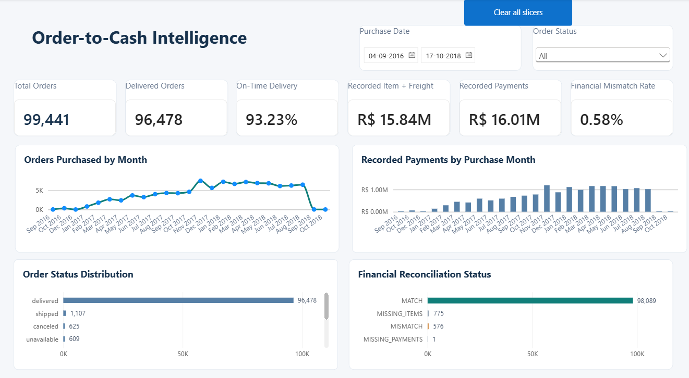
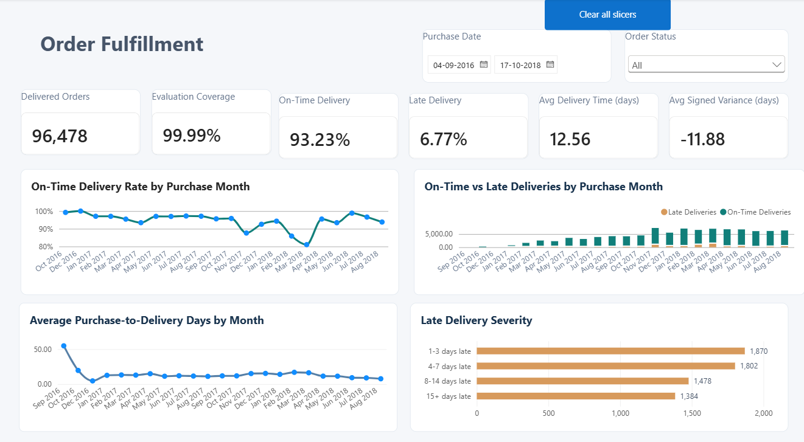
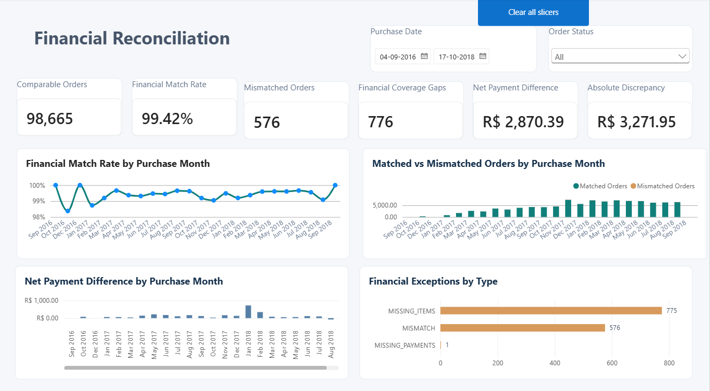
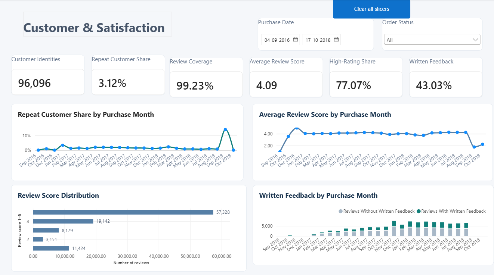
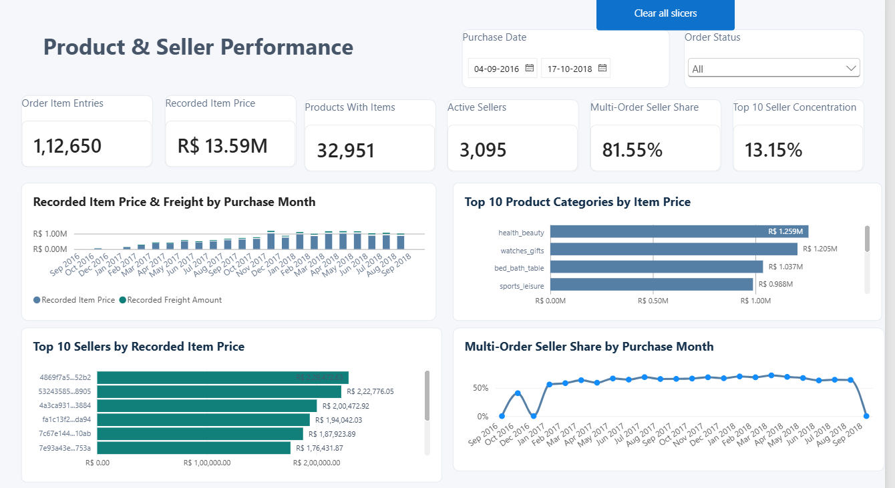
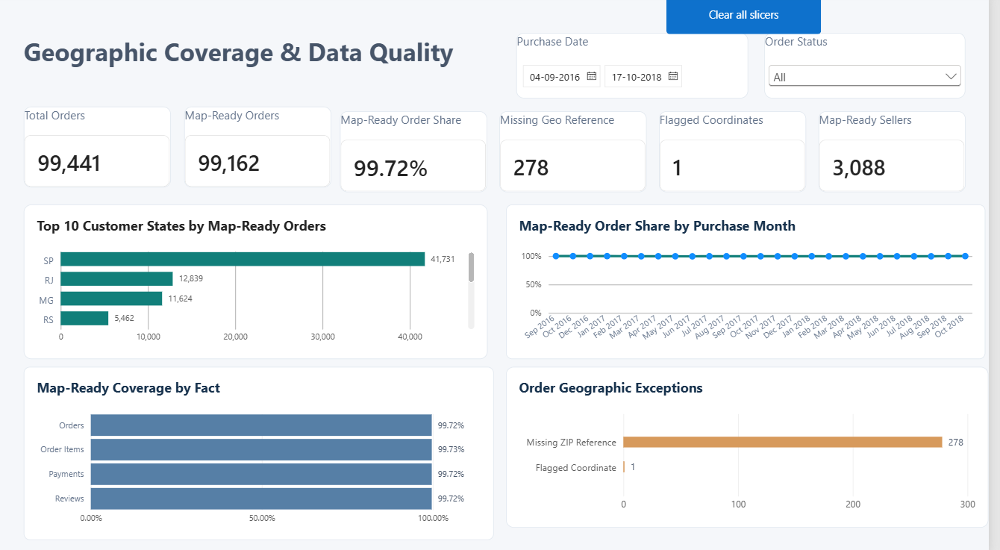

# Power BI Dashboard Guide

## Overview

The Order-to-Cash Intelligence Platform includes six Power BI report pages designed around related but distinct business measurement areas.

Each page includes:

- Six headline KPI cards
- Four analytical visuals
- Purchase Date slicer
- Order Status slicer
- Clear all slicers control

The Purchase Date slicer defines an order-purchase cohort, not the dates when payments were processed or reviews were submitted.

All results are historical.

---

## Page 01 — Executive Overview

### Purpose

Provide a consolidated view of order activity, delivery performance, recorded monetary values, and financial reconciliation.

### Headline KPIs

| KPI | Full Dataset |
|---|---:|
| Total Orders | 99,441 |
| Delivered Orders | 96,478 |
| On-Time Rate | 93.23% |
| Recorded Item + Freight | R$15.84M |
| Recorded Payments | R$16.01M |
| Financial Mismatch Rate | 0.58% |

### Visuals

- Monthly order volume
- Monthly recorded payments
- Order-status distribution
- Financial reconciliation-status distribution

### Interpretation

Recorded item and payment amounts are historical source-recorded values, not audited profit, revenue recognition, or cash settlement.

---

## Page 02 — Order Fulfillment

### Purpose

Evaluate delivery timeliness, duration, and lateness severity.

### Headline KPIs

| KPI | Full Dataset |
|---|---:|
| Delivered Orders | 96,478 |
| Delivery Evaluation Coverage | 99.99% |
| On-Time Rate | 93.23% |
| Late Rate | 6.77% |
| Average Purchase-to-Delivery Days | 12.56 |
| Signed Delivery Variance Days | -11.88 |

### Visuals

- Monthly on-time delivery rate
- Monthly on-time versus late delivered orders
- Monthly average purchase-to-delivery duration
- Late-delivery severity distribution

### Interpretation

The on-time rate uses delivery-evaluable orders.

The signed delivery variance measures actual delivery timing relative to the estimated delivery date.

Negative variance indicates delivery before the estimate.

---

## Page 03 — Financial Reconciliation

### Purpose

Evaluate agreement between recorded order item/freight totals and associated recorded payment totals.

### Headline KPIs

| KPI | Full Dataset |
|---|---:|
| Comparable Orders | 98,665 |
| Financial Match Rate | 99.42% |
| Mismatched Orders | 576 |
| Financial Coverage Gaps | 776 |
| Net Comparable Payment Difference | R$2,870.39 |
| Absolute Financial Discrepancy | R$3,271.95 |

### Visuals

- Monthly financial match rate
- Monthly matched and mismatched order counts
- Monthly net payment difference
- Financial exceptions by type

### Interpretation

Comparable orders contain sufficient item and payment information for the order-level reconciliation.

Net difference is signed and can contain offsetting discrepancies.

Absolute discrepancy sums per-order absolute differences.

Financial coverage gaps are distinct from comparable mismatches.

---

## Page 04 — Customer & Satisfaction

### Purpose

Analyze customer ordering activity and review satisfaction for purchase-date cohorts.

### Headline KPIs

| KPI | Full Dataset |
|---|---:|
| Customer Identities | 96,096 |
| Repeat Customer Share | 3.12% |
| Review Coverage | 99.23% |
| Average Review Score | 4.09 |
| High-Rating Share | 77.07% |
| Written Feedback Availability | 43.03% |

### Visuals

- Monthly repeat-customer share
- Monthly average review score
- Review score distribution
- Written versus nonwritten feedback by purchase month

### Interpretation

Customer identities represent distinct pseudonymous source identities.

Repeat customer share measures repeat ordering within the selected cohort.

Review records are not necessarily unique reviewed orders.

Average Review Score is weighted by individual review records, not the unweighted mean of monthly averages.

Monthly review metrics refer to associated order purchase months.

---

## Page 05 — Product & Seller Performance

### Purpose

Analyze recorded order-item contribution, product activity, and seller participation.

### Headline KPIs

| KPI | Full Dataset |
|---|---:|
| Order Item Entries | 112,650 |
| Recorded Item Price | R$13.59M |
| Products With Item Records | 32,951 |
| Active Sellers | 3,095 |
| Multi-Order Seller Share | 81.55% |
| Top 10 Seller Concentration | 13.15% |

### Visuals

- Monthly recorded item price and freight
- Top 10 product categories by recorded item price
- Top 10 sellers by recorded item price
- Monthly multi-order seller share

### Interpretation

Recorded item price excludes freight.

Seller concentration measures item-price contribution, not seller profit.

Multi-order seller share means the proportion of participating sellers associated with at least two distinct orders in the selected cohort.

Product and Seller dimensions filter the Order Items fact but are not interpreted as whole-order payment allocations.

---

## Page 06 — Geographic Coverage & Data Quality

### Purpose

Evaluate geographic reference coverage, customer-state activity, and record-level geographic data quality.

### Headline KPIs

| KPI | Full Dataset |
|---|---:|
| Total Orders | 99,441 |
| Map-Ready Orders | 99,162 |
| Map-Ready Order Share | 99.72% |
| Missing Geo Reference | 278 |
| Flagged Coordinates | 1 |
| Map-Ready Sellers | 3,088 |

### Visuals

- Top 10 customer states by map-ready order count
- Map-ready order share by purchase month
- Map-ready geographic coverage by fact
- Order geographic exceptions

### Interpretation

The state chart shows geographic distribution using customer-state reference information.

Map-ready status is based on screened ZIP-prefix reference data.

It does not indicate exact customer addresses.

Orders without geographic references remain included in the total-order denominator.

The Seller dimension's geographic readiness is independent of the purchase-date cohort unless explicitly modeled otherwise.

---

## Standard Validation Cohort

A common test cohort is used across all pages:

**Purchase Date:** January 1–March 31, 2018

**Order Status:** delivered

This represents 20,627 orders purchased during Q1 2018 that have delivered status in the historical extract.

Each page should independently reproduce its documented cohort metrics.

---

## Filtering and Interactions

The Purchase Date and Order Status slicers filter relevant visuals on their respective pages.

Selected monthly trend points can filter other compatible reporting visuals by purchase month.

Some category and fact-level charts have outgoing interactions disabled deliberately.

This avoids misleading cross-filtering between order, item, payment, review, seller, and geographic measurement grains.

Slicer selections are page-specific unless synchronization is separately configured.

---

## Dashboard Limitations

The reports are built from historical marketplace records and should not be represented as live operational dashboards.

The reporting outputs are not audited financial statements.

The dataset includes pseudonymous customer identifiers.

Exact residential addresses and delivery GPS positions are not provided by the geographic visual.

For complete definitions, see `kpi_dictionary.md`.

For validation results, see `validation.md`.
